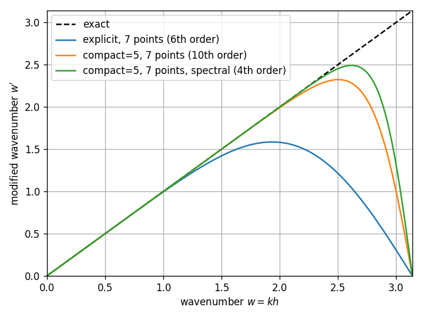

==========================
Compact Finite Differences
==========================

.. versionadded:: 0.13

Compact (or implicit) finite differences achieve spectral-like resolution with
small stencils by coupling derivative approximations at neighboring grid points.
The classical reference is Lele (1992).

Background
----------

Standard ("explicit") finite differences express a derivative as a weighted sum
of function values:

.. math::
   f'_i = \sum_k c_k \, f_{i+k}

Compact finite differences generalize this by including derivative values on the
left-hand side:

.. math::
   \sum_k \alpha_k \, f'_{i+k} = \sum_k c_k \, f_{i+k}

The classic tridiagonal case uses :math:`\alpha_{-1} = \alpha_1 = 1/3` and five
function values. Despite needing only nearest neighbors, this scheme reaches
6th-order accuracy — the same as a 7-point explicit stencil.

The price is that computing the derivative requires solving a banded linear
system. For a tridiagonal left-hand side this costs :math:`O(N)` and is fast in
practice.

Usage
-----

There are two ways to set up a compact scheme.

**Explicit scheme definition** — pick the left-hand side coefficients
(:math:`\alpha`) and right-hand side offsets, and *findiff* solves for the
matching :math:`c_k`:

.. code:: python

    import numpy as np
    from findiff import Diff, CompactScheme

    x = np.linspace(0, 2 * np.pi, 100, endpoint=False)
    dx = x[1] - x[0]

    # Lele (1992) tridiagonal scheme, Section 2.1.1
    scheme = CompactScheme(
        deriv=1,
        left={-1: 1/3, 0: 1, 1: 1/3},
        right=[-3, -2, -1, 0, 1, 2, 3],
    )

    d_dx = Diff(0, dx, scheme=scheme, periodic=True)

    f = np.sin(x)
    df = d_dx(f)            # 6th-order accurate

**Shortcut** — let *findiff* choose a scheme that meets a target accuracy:

.. code:: python

    d_dx = Diff(0, dx, compact=3, acc=6, periodic=True)

The ``compact`` parameter sets the number of left-hand side points (must be an
odd integer). *findiff* determines the left-hand side :math:`\alpha_k` and the
right-hand side :math:`c_k` jointly, so that the accuracy order is maximal for
the given stencil widths (Lele, 1992), and uses the narrowest right-hand side
stencil that reaches the requested accuracy. This yields the classical schemes,
for example:

=====================  ========================================  ===============
Parameters             Left-hand side                            Right-hand side
=====================  ========================================  ===============
``compact=3, acc=4``   :math:`\alpha_1 = 1/4` (Padé)             3 points
``compact=3, acc=6``   :math:`\alpha_1 = 1/3`                    5 points
``compact=5, acc=8``   :math:`\alpha_1 = 4/9,\ \alpha_2 = 1/36`  5 points
``compact=5, acc=10``  :math:`\alpha_1 = 1/2,\ \alpha_2 = 1/20`  7 points
=====================  ========================================  ===============

As with explicit finite differences, ``acc`` is the minimum accuracy order;
the scheme may be more accurate if no narrower stencil exists.

Higher derivatives
------------------

Use the ``**`` operator:

.. code:: python

    d2_dx2 = d_dx ** 2

This automatically constructs a new compact scheme for the second derivative
with matching accuracy.

Spectral-like resolution
------------------------

.. versionadded:: 0.15

The schemes above spend all free parameters on the accuracy order. Lele's
*spectral-like* schemes impose only a moderate order and use the remaining
parameters to resolve short waves better. This pays off for multi-scale problems
(turbulence, shocks, the Burgers equation), where the solution contains
wavelengths of only a few grid points.

.. code:: python

    d_dx = Diff(0, dx, compact=5, acc=4, spectral=True, periodic=True)
    d2_dx2 = d_dx ** 2          # also spectrally optimized

With ``spectral=True`` the right-hand side has ``compact + 2`` points. For full
control, construct the scheme directly:

.. code:: python

    scheme = CompactScheme.spectral(deriv=1, num_left=5, num_right=9, acc=6)
    d_dx = Diff(0, dx, scheme=scheme, periodic=True)

The accuracy order ``acc`` is imposed exactly; the remaining coefficients minimize
the error of the *modified wavenumber* in the least-squares sense on
:math:`[0, w_{max}]`. By default, :math:`w_{max}` is chosen to maximize the
*resolving efficiency*: the fraction of :math:`[0, \pi]` in which the relative
error of the modified wavenumber stays below ``tol`` (default ``1e-3``). Pass
``max_wavenumber`` to fix the range instead. Both quantities are available for
any scheme:

.. code:: python

    scheme.modified_wavenumber(w)      # w' for scaled wavenumbers w = k h
    scheme.resolving_efficiency(1e-3)  # e.g. 0.56 -> 0.70 for compact=5, 7 points

The trade-off: for well-resolved, smooth functions a scheme of maximal order is
more accurate, while the spectral scheme wins for short waves. On non-periodic
grids, the boundary closures (which have maximal order) dominate the error for
short waves within the first few grid points.

Non-periodic boundaries
-----------------------

For non-periodic grids the interior stencil extends past the boundary at the
first and last few grid points. *findiff* handles this with one-sided compact
stencils (Visbal & Gaitonde, 2002): the left-hand side alphas and right-hand
side offsets are restricted to points that exist, and the system is re-solved for
the boundary rows. Since one-sided stencils lack the symmetry of the interior
scheme, the right-hand side stencil is widened at the boundary until it reaches
the interior accuracy order (as far as the grid size permits).

.. code:: python

    x = np.linspace(0, 1, 100)
    dx = x[1] - x[0]

    d_dx = Diff(0, dx, scheme=scheme, periodic=False)
    df = d_dx(np.sin(x))

Non-uniform grids
-----------------

.. versionadded:: 0.15

Pass the coordinates instead of the spacing, as for explicit differences:

.. code:: python

    x = (1 - np.cos(np.pi * np.linspace(0, 1, 100))) / 2   # clustered at both ends

    d_dx = Diff(0, x, compact=3, acc=6)
    df = d_dx(np.sin(x))
    d2_dx2 = d_dx ** 2

The left-hand side keeps the :math:`\alpha_k` of the uniform scheme, which keeps
the banded system well-conditioned on any grid. The right-hand side coefficients
are solved row by row from the actual grid spacings. Without the symmetry of a
uniform grid, the right-hand side needs ``acc + deriv`` points (rounded up to an
odd number) to reach accuracy order ``acc``, so the stencil is as wide as for
explicit differences. The benefit of the compact scheme on non-uniform grids is
therefore a smaller error constant rather than a narrower stencil. The scheme
reproduces polynomials of degree up to the stencil width minus one exactly on
any grid.

Multi-dimensional grids
-----------------------

Compact differentiation extends to N-dimensional arrays via Kronecker products:

.. code:: python

    x = y = np.linspace(0, 2 * np.pi, 100, endpoint=False)
    dx = x[1] - x[0]
    X, Y = np.meshgrid(x, y, indexing='ij')

    d_dx = Diff(0, dx, compact=3, acc=6, periodic=True)
    d_dy = Diff(1, dx, compact=3, acc=6, periodic=True)

    f = np.sin(X) * np.cos(Y)
    laplacian = (d_dx**2 + d_dy**2)(f)

You can freely mix compact and standard finite difference operators in the same
expression.

Matrix representation
---------------------

The matrix form of a compact operator is :math:`L^{-1} R`. Obtain it with
the usual ``matrix()`` call:

.. code:: python

    M = d_dx.matrix((100,))
    df = M.dot(f)

Note that inverting the banded :math:`L` introduces fill-in, so the matrix is
denser than for explicit finite differences: each row couples all points on its
grid line along the differentiation axis. On an :math:`n \times n` grid the
matrix therefore has :math:`n^3` non-zero entries.

Limitations
-----------

- Periodic non-uniform grids are not supported (as for explicit differences).
- The ``stencil()`` method is not supported for compact schemes.
- ``estimate_error()`` does not support compact schemes and raises an error.
- Compact schemes run on NumPy / SciPy only. JAX or CuPy arrays are converted
  to NumPy arrays (see :doc:`gpu-backends`).
- The grid must have at least as many points along the differentiation axis as
  the stencil reaches away from a point; otherwise a ``ValueError`` explains
  the required size.

References
----------

- S. K. Lele, "Compact Finite Difference Schemes with Spectral-like Resolution",
  *J. Comp. Phys.* **103**, 16-42 (1992).
- M. R. Visbal and D. V. Gaitonde, "On the Use of Higher-Order Finite-Difference
  Schemes on Curvilinear and Deformed Meshes", *J. Comp. Phys.* **181**, 155-185
  (2002).
